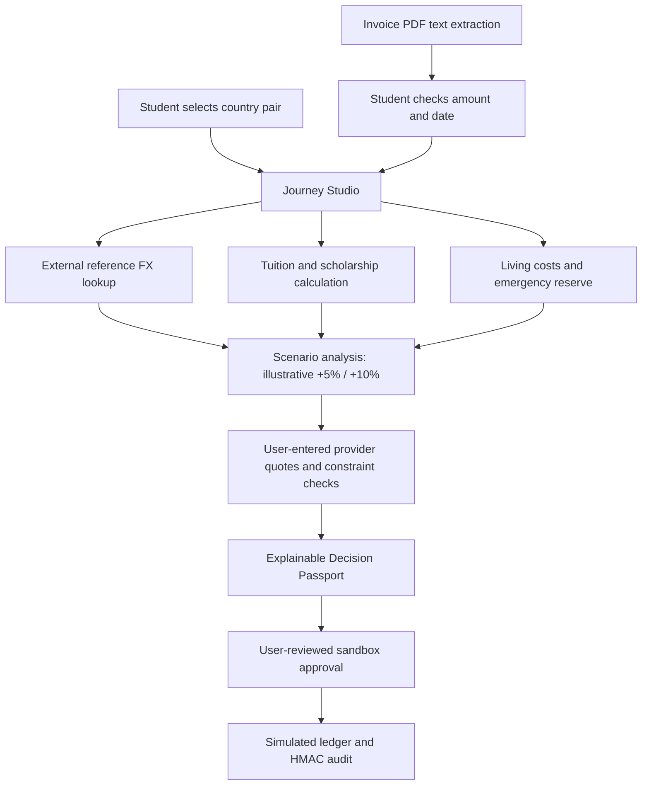
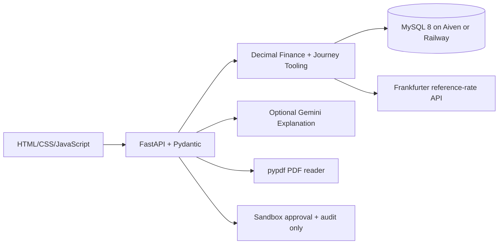

# Technical Addendum — Current StudentBridge AI Build

This supplements `docs/TECHNICAL_DOCUMENTATION.pdf`. The original technical document describes the core MySQL architecture and deterministic quote evaluation; this addendum covers the newer guided journey and public-demo safety changes.

## Student journey

## Current additions

- `app/journey.py`: goal-based financial preview, deadline checks, calendar export; output is a plan, not a payment order.
- `POST /api/journey/prepare`: orchestrates approved calculation and reference tools; does not connect to actual bank/loan accounts.
- `GET /api/journey/calendar`: generates `.ics` reminders with escaped text and selected pre-deadline notification offset.
- `POST /api/invoices/analyze`: reads text-based PDF candidate fields using `pypdf` and requires review; scanned image PDFs are not automatically OCRed.
- `app/static/clarity-v9.css`: design and typography refinements.
- In production, shared history/audit endpoints return 403. User authentication/record ownership are not implemented.

## Dependency architecture

For database tables, formulae, complete screenshots, API request examples and run instructions, start at `README.md` in the root. To demonstrate actual MySQL connectivity, run `python scripts/check_mysql.py` against your own **private test database**. Do not publish its credentials.
